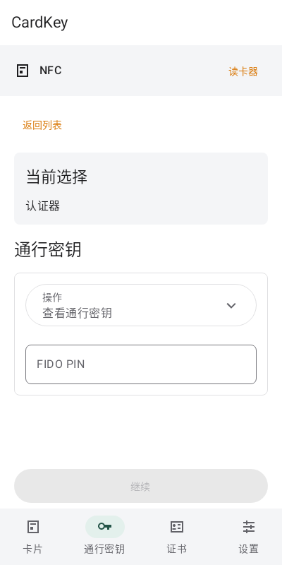
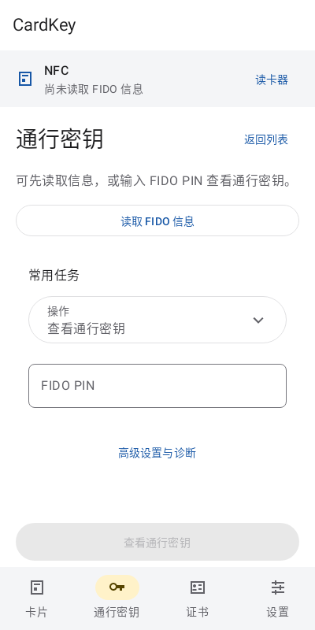
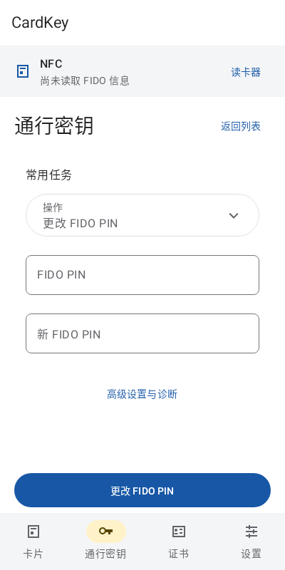
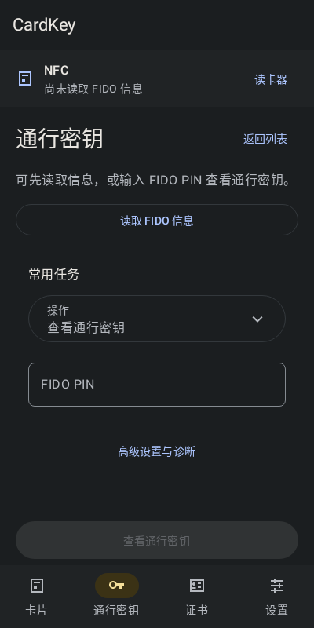

# FIDO manager workspace validation

Refs #45. Runtime source `65f870584af7d8001eb4b712a673861121e907d8`, following `d059624ce67fd50d3340a35a802be91bcbeaf214`, based on default `4ab71057c8c1e23c453fd6551c70c8f0a0187564`. This record changes documentation only.

The manager keeps its delivered FIDO-first and secure PIN-first flow. It adds an explicit existing FIDO-only information read, displays current-route observation without claiming ongoing card presence or initialization, removes the generic selected-authenticator panel from the task viewport, and moves the list control into the FIDO heading. PIN-change and other selected tasks omit inventory landing guidance. The inventory submit action names its result. Blue primary/yellow accent colors are scoped to FIDO, Device and Settings; provider, PIV/enrollment theme consumers and protocol/ownership behavior are unchanged. Exact reviewed copy is in `FIDO-WORKSPACE-COPY.md`.

## Targeted verification

- The original-source synthetic baseline rendered unread FIDO, PIN task and retained result in 53 seconds (54.06 seconds wall). The same isolated fixture supplies the comparison images; it never instantiates MainActivity or connects hardware.
- An initial affected run executed 94 cases: 89 passed and five failed. Three failures were the former `继续` selector after the inventory button became `查看通行密钥`; one was the exact reader-name selector after a prefixed header; one was the fixed translated-key set. The reader name was restored as a standalone label. Existing geometry assertions were retained and now address the exact `manager-run` control. Catalog checks explicitly include the six reviewed new keys.
- The bounded repair executed 47 cases: 43 passed and four failed. Remaining failures were three ambiguous inventory-text selectors and an invalid dark-fixture qualifier order. The exact control selector and qualifier were corrected; passed localization checks were reused.
- Final `ManagerScreenLayoutTest` and `PlexoWorkspaceTest`: **34 cases, zero failures/errors/skips**, 8.869 seconds summed suite time; Gradle 40 seconds, wall 40.65 seconds. All original inset, task navigation, permission/secret retirement, unknown result, selected-target, result/export and geometry assertions remain. New cases check explicit public-read dispatch without PIN or task change, route-matched observation, no absent-applet claims, passive synthetic renders, dark mode and large-text landscape. The PIN preview asserts both secure fields visible before IME and omits inventory landing guidance.
- Unaffected passing cases in the first targeted run are reused for `PlexoPresentationRegressionTest`, `ManagerRecognitionTest`, `InventoryPanelTest`, `InventoryViewModelTest`, `CopyPruningTest` and `UserUpdateHelpTest`. Localization and locale/catalog cases passed in the bounded repair. No single final full-suite pass is claimed and no test floor was reduced.

The final `assembleDebug assembleDebugAndroidTest lintDebug --offline --no-daemon --no-watch-fs --max-workers=2 -Pkotlin.incremental=false` gate passed in **45 seconds** (46.42 seconds wall). Both APKs built. Lint reports zero errors and 11 warnings: one existing `PluralsCandidate` on the unchanged English retry-count string, one `GetInstance`, and nine `TrustAllX509TrustManager`. No suppression, baseline, dependency or tool pin was changed. The full unit suite was not repeated for visual reassurance.

## Artifacts and acceptance boundary

The local delivery is `.cardkey-delivery/current-fido-20261024/android-ui/` outside this repository. It retains full logs, final geometry JUnit XML, lint XML, source-bound APKs, signature verification output and synthetic before/final previews. Existing JDK 17.0.20.1+1, Gradle 8.13, SDK API 36/build-tools 35.0.0, AGP 8.13.2 and Kotlin 2.3.0 were used offline with at most two workers.

`CardKey-fido-workspace-debug.apk`: 42,611,773 bytes, `cc.cardkey.android`, version `0.1.0` / code `1`. `CardKey-fido-workspace-instrumentation.apk`: 2,473,687 bytes, `cc.cardkey.android.test`. Both pass build-tools `apksigner verify --verbose --print-certs` with the existing Android Debug certificate SHA-256 `83d41e07f0f200c4c135c7432e5aa28f2ace23540d3a25d1126789bb675c9951`; this serves the concrete same-signer update invariant, not a tracking manifest or release-signing claim.

Final synthetic PNGs include unread light/dark, PIN task, retained result and large-text landscape; they were visually inspected. These are Android Canvas/Robolectric fixtures with synthetic data. No new UI APK was installed, no device was launched, and no card, PIN, APDU, provider, account or firmware operation occurred. Owner clarified that the intended target card is not programmed; historical FW17 does not identify this target. Root owns publication, native installation/synthetic device tests and any separately authorized physical acceptance. The existing Sony stay-awake value `3` is unchanged.

## Synthetic visual comparison

These existing isolated Android Canvas/Robolectric renders use synthetic state only. The before image represents base runtime `4ab71057`; final images represent runtime `65f8705`. The PIN task contains empty secure fields, not a real PIN. These are not phone screenshots, physical-card proof or Owner device acceptance. No new rendering or device operation was performed to package them.

| Before: unread workspace | After: unread workspace |
| --- | --- |
|  |  |

| After: PIN task | After: dark mode |
| --- | --- |
|  |  |
