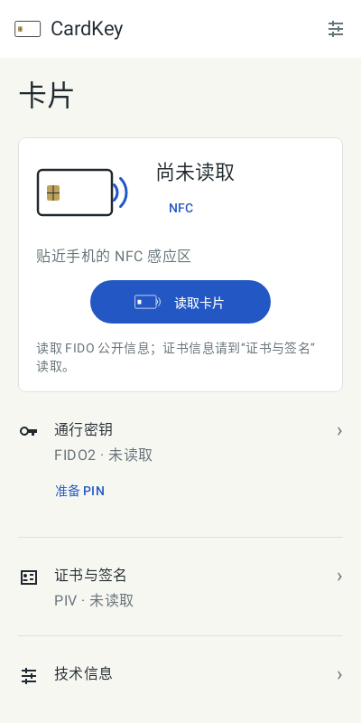
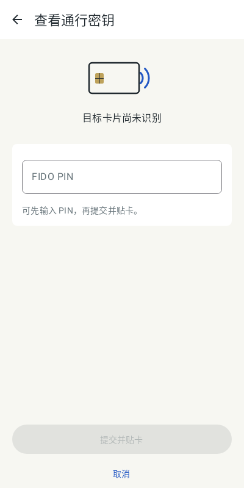
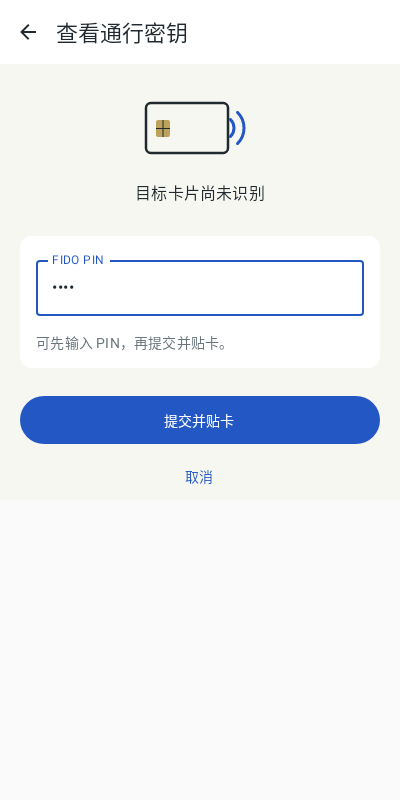

# Approved native card workspace validation

Refs #45. Base: `14b1b694738ac7e774bf5b35e874732f052fa992`. Branch: `ui/native-card-workspace-20261025`. This package implements the Owner-approved Android home/inventory-preparation concept and final in-page card/button refinement. Launcher assets, dependencies, protocols and permissions are unchanged. Exact Chinese/English copy, task semantics and activation scope are recorded in `FIDO-WORKSPACE-COPY.md`.

## Implemented behavior

Cold launch is a passive card home without a PIN form or automatic command. The scoped read action uses existing FIDO_INFO and states that certificate/PIV reading is separate. Home preparation opens a focused **View passkeys** task with the existing FIDO PIN field; entering a task does not authenticate. Explicit submission alone invokes the original complete inventory flow. PIN setup/change remain separate tasks. Current-route observations supply independent FIDO/PIV display evidence; unread state never claims absent applets or initialization.

The home uses warm porcelain, graphite and cobalt, a compact rounded smart card with contact chip, and a smaller solid cobalt read pill. NFC arcs and presentation wording appear only for NFC; USB selection and original transport restrictions remain. Original loaded artwork and loading/failure/retry paths remain available. The manager's full FIDO/PIV task workspaces, account selection/rename/delete/blob, protected PIV, slots/admin, files/exports, provider settings, enrollment/TLS and advanced/U2F/reset/identity paths remain reachable. The provider UI and enrollment workflow are not redesigned.

Original submission/confirmation, cancellation, secret retirement, FLAG_SECURE, last-attempt consent, busy/permission guards, unknown-write fences and captured-report ownership remain. Back/cancel from local preparation clears its inputs; it does not claim to undo dispatched operations. Successful inventory returns to the existing account-management workspace.

## Checks and retained evidence

- Initial synthetic home/PIN/artwork run: 22 cases, 20 passed; two fixture failures concerned a newly translated preparation label and duplicated decorative glyph description. Locale-aware selection and meaningful versus decorative glyph semantics corrected these while preserving all behavior assertions. A subsequent compile caught a trailing-lambda caller after adding the optional NFC artwork presentation parameter; actual callers were updated explicitly.
- Affected native gate: **55 cases in six suites, zero failures/errors/skips**, 30.309 seconds summed test time; Gradle **4m04s**, wall **245.44s**. Suites: `PlexoWorkspaceTest` (15), `ConsumerManagerTest` (3), `PlexoPresentationRegressionTest` (4), `ManagerScreenLayoutTest` (20), `ProtectedPivLocaleListTest` (6), `ProtectedPivLocalizationTest` (7). Existing passive navigation, task/export/selection ownership, PIN-first permission retirement, unknown-result, original artwork bounds and system-inset assertions are preserved. The focused preparation IME case asserts visible input/submit above reserved IME space and zero dispatches.
- Final normal package/lint gate also ran only three affected actual-preview cases after the compact IME fixture correction and exact cobalt dark-mode read styling: **3 passed, zero failures/errors/skips**, 36.080 seconds summed tests. `assembleDebug`, `assembleDebugAndroidTest` and `lintDebug` all passed. Gradle **4m10s**, wall **251.55s**. Lint: zero errors and 11 existing-source warnings (one PluralsCandidate, one GetInstance, nine TrustAllX509TrustManager), no baseline or suppression. The remaining passed affected cases and unchanged protocol/crypto evidence are reused; no full-suite rerun is claimed.

Existing JDK 17.0.20.1+1, Gradle 8.13, SDK API 36/build-tools 35.0.0, AGP 8.13.2 and Kotlin 2.3.0 were reused offline with at most two workers. Full logs, JUnit/lint XML, additional light/dark/large-text/result previews and source-bound APKs are retained outside Git in `.cardkey-delivery/current-fido-20261025/android-native/`.

The existing two `WorkspaceAcceptanceTest` methods now also traverse passive home → PIN preparation → Back, checking empty secure preparation, FLAG_SECURE and zero dispatches before continuing their original navigation/real-IME assertions. They compile into the matching test APK; they were not executed on a phone in this package.

## Actual candidate previews

These unmodified Android Canvas/Robolectric images render the implemented candidate with synthetic state. They are not generated concept art or phone screenshots. The IME image reserves a 300dp synthetic inset; it contains only masked synthetic test text and does not depict a real system keyboard. Root inspected the composition against the approved concept; Owner/device acceptance remains separate.

| Passive home | Focused inventory preparation |
| --- | --- |
|  |  |

## Artifacts and remaining acceptance

Initial layout artifacts, superseded by the Back correction below: `CardKey-native-debug.apk`, 43,594,965 bytes, application `cc.cardkey.android`, version `0.1.0` / code `1`; `CardKey-native-instrumentation.apk`, 2,528,704 bytes, `cc.cardkey.android.test`. Both pass `apksigner verify --verbose --print-certs` with the existing Android Debug certificate SHA-256 `83d41e07f0f200c4c135c7432e5aa28f2ace23540d3a25d1126789bb675c9951`. This serves the concrete same-signer installation invariant, not release signing or a tracking manifest. Use the matching test APK because its preparation assertions changed.

No device query, install, launch, real PIN, card/APDU, provider activation, RP, GP/PIV or firmware operation occurred. The physical session remains cancelled; the target card is not programmed. Root owns publication, remote gates, signed Android delivery and later isolated native UI/IME execution. Owner visual acceptance and real card/system acceptance remain separate.

## Focused inventory system Back correction

The initial unpublished candidate `f80bbc8` left the inner legacy object-detail BackHandler enabled during focused inventory preparation. Because that handler is composed later, system Back did not reach the intended home handler. The regression invokes the actual `OnBackPressedDispatcher` after preparing a synthetic PIN: it failed against the original runtime at the missing `native-card-home` assertion (one test, one failure; Gradle 2m39s / 160.81s wall).

The runtime fix adds only `!focusedInventory` to the inner handler condition. The focused handler now returns home and clears local preparation; legacy detail-to-object Back remains unchanged. Five narrow tests passed with zero failures/errors/skips: focused system Back and empty PIN on reopening, legacy PIV slot/object Back, permission-based secret retirement, explicit public read without authentication, and focused IME bounds/no dispatch. Summed tests: 11.933 seconds. The same command rebuilt the matching application/test APKs; Gradle 1m32s / 93.01s wall. Unrelated passed 55-case and lint evidence above is reused; no broad suite or lint rerun was needed for this one-condition change.

Latest artifacts are under `.cardkey-delivery/current-fido-20261025/android-native/system-back-fix/`: application APK 44,568,997 bytes and instrumentation APK 2,528,704 bytes, both independently signature-verified with the same established certificate. Red/green XML and full logs are retained outside Git. Existing synthetic screenshots remain applicable because this correction changes Back dispatch rather than visual composition. No device or card action occurred.
