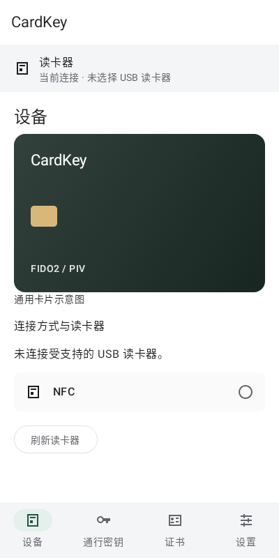
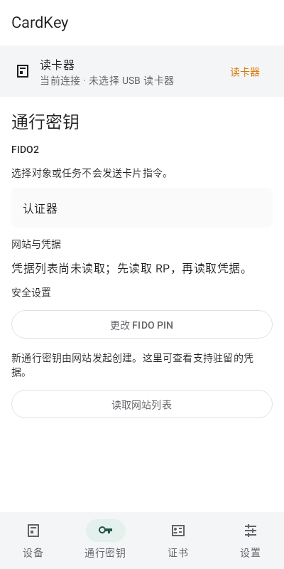

# Native Plexo UI validation

Owning issue: qianxueye/cardkey-android#31. Branch: feat/plexo-ui-20261020, based on e4b68ba658c1a38f98b9ac6f5221eae688e67d8d.

## Behavior

The phone manager starts on Device and provides native Device, Passkeys, Certificates and Settings destinations. FIDO2/PIV context, website/account rows and PIV slot codes remain visible. Common PIN and website-list tasks open their existing forms without sending a card command. Provider settings and certificate enrollment remain reachable from Settings. Every PIN form identifies FIDO PIN, PIV PIN or PUK. Card commands, result receipts, confirmation, permission, recognition and uncertain-write gates retain their existing behavior.

CardArtworkSource is consumed by ManagerScreen. Opaque public references and revisions are supplied by the owning application context. The default source is unconfigured. The generic illustration is labeled; loading, loaded, failed and image-only retry states are implemented. PNG/JPEG input is bounded to 4 MiB, 4096 pixels per edge and 16 million pixels; decoded previews have a longest edge of at most 1200 pixels. Cancellation/replacement/clearing prevents stale display. A current-source timeout exposes retry and preserves parent coroutine ownership. No database, endpoint, private asset or inferred card binding was added.

## Evidence and check reuse

- assembleDebug passed; the debug APK was built locally.
- The full unit run covered 852 cases. Its only remaining failures were two stale test selectors (reader navigation and the localized byte count), and its only skipped case was the existing optional OpenSSH gate. The two selectors were corrected.
- A focused 23-case run of both affected lifecycle classes plus the external OpenSSH gate passed with zero failures and zero skips. OpenSSH used the installed system executable and synthetic keys.
- After the bounded artwork-cancellation correction, all 10 artwork tests passed with zero failures and zero skips. Other passed cases were reused because their runtime paths were unchanged. The focused suite uses Robolectric native graphics and initializes its codec before dispatcher-based tests. Assertions and deadlines were retained.
- assembleDebugAndroidTest passed after updating the retained acceptance-test navigation. The instrumentation APK was compiled; it was not installed or executed.
- lintDebug passed with zero errors. Existing warnings/hints remain visible; no lint baseline, suppression or test weakening was introduced.

Preserved full and focused JUnit reports/logs are in app/build/ui-evidence/. Reproduce the disconnected phone previews with PlexoWorkspaceTest.taskNavigationKeepsDeviceAndSettingsPassive; outputs are app/build/ui-previews/device.png and passkeys.png. They were rendered through the native Android Canvas under Robolectric and visually inspected. They use explicit disconnected state, do not instantiate MainActivity, and do not enumerate live readers or send card commands.

Toolchain: existing JDK 17, Gradle 8.13 and Android SDK 36. The full suite used installed Smallstep CLI 0.31.0 and step-ca 0.30.2 for its local synthetic CA fixtures. Missing public test dependencies were resolved once, then cached checks ran offline.

## Disconnected native previews

These committed PNGs are the already verified Robolectric Canvas outputs described above. They show a generic card illustration and unread/disconnected state; they do not show physical-device acceptance.

## Primary design references

The implementation uses familiar task categories, website/account rows, distinct PIN management and native controls. Reference products do not establish CardKey hardware or platform capabilities.

- [Yubico Authenticator: Passkeys / FIDO2](https://docs.yubico.com/software/yubikey/tools/authenticator/auth-guide/fido2.html)
- [Yubico Authenticator: Home and selected-device context](https://docs.yubico.com/software/yubikey/tools/authenticator/auth-guide/home.html)
- [Android passkey UI guidance](https://developer.android.com/design/ui/mobile/guides/patterns/passkeys)

## Acceptance boundary

This evidence covers application source, local builds, synthetic protocol/lifecycle tests and native JVM-rendered previews. No phone/card/reader access, APK installation, installed-manager launch, provider activation, external-account acceptance or production deployment occurred. Device UI/keyboard, USB/NFC and provider/account acceptance remain separate.
