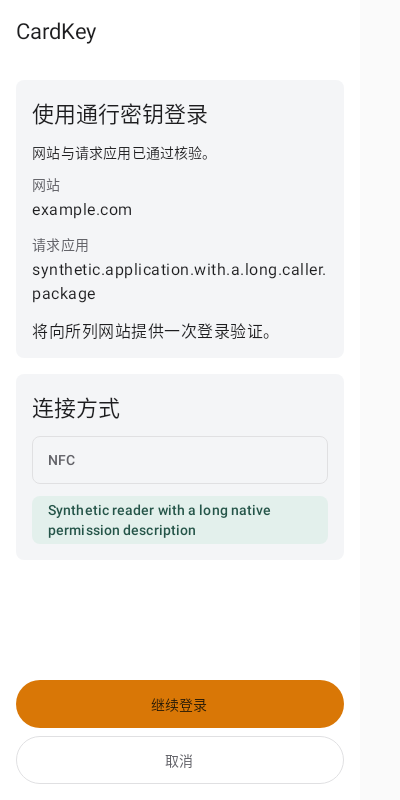
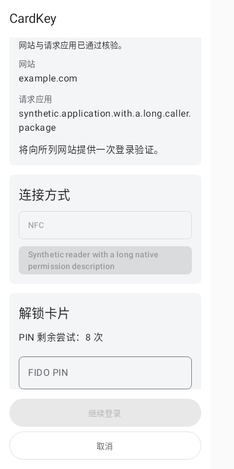
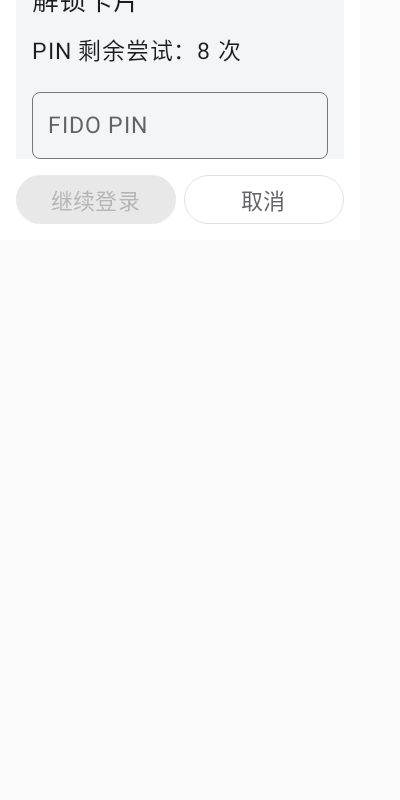

# Provider consumer integration and delivery evidence

Issue #33. This record packages the combined CardKey manager and provider application after the normal manager merge. It changes no runtime source or tests. The [provider copy review](PROVIDER-CONSUMER-COPY-REVIEW.md) owns the provider before/after wording and supersedes the historical provider rows in the [manager record](CONSUMER-COPY-REVIEW.md).

## Source and parent

- Provider source candidate: `d950e636774bd25ee9daacc0206684d166b4cc34`.
- Manager PR #34 merged normally at `7ca87b0a5072cdb78663e4ec5ba07b43131af382`.
- Signed integration source: `23f3e4d2d576a497b2e096efe4b148ff9b852507`, with parents `d950e636774bd25ee9daacc0206684d166b4cc34` and `7ca87b0a5072cdb78663e4ec5ba07b43131af382`.
- This packaging step contains evidence and the already inspected synthetic previews only. The APK inputs remain the verified integration source above.

## Post-parent verification

Root's post-parent run passed `assembleDebug`, `lintDebug`, `assembleDebugAndroidTest` and the four targeted classes below in 1m41s. Counts were read from the existing JUnit XML under `app/build/test-results/testDebugUnitTest`; no checks were rerun for this packaging step.

| Existing JUnit XML class | Tests | Failures | Errors | Skipped |
|---|---:|---:|---:|---:|
| `cc.cardkey.provider.PlexoProviderTest` | 8 | 0 | 0 | 0 |
| `cc.cardkey.provider.ProviderRecognitionActivityTest` | 7 | 0 | 0 | 0 |
| `cc.cardkey.signing.PivFileSigningPanelTest` | 6 | 0 | 0 | 0 |
| `cc.cardkey.ui.InventoryPanelTest` | 5 | 0 | 0 | 0 |
| Total | 26 | 0 | 0 | 0 |

The run covers provider presentation/activity ownership and the coupled manager inventory/signing panel corrections after the parent merge. Earlier passed protocol, origin, request, PIN and lifecycle evidence is retained in the provider copy review. Instrumentation was compiled, not executed. Root retains the run log as `cardkey-android-provider-parent-integration.log`.

## APK delivery and signing

The existing build outputs were copied into the workspace delivery tree:

| Delivery directory | Application APK | Instrumentation APK |
|---|---|---|
| `.cardkey-deliveries/20261020/consumer-workflows/android-provider/` | `CardKey-provider-debug.apk` | `CardKey-provider-instrumentation.apk` |
| `.cardkey-deliveries/20261020/consumer-workflows/android-manager/` | `CardKey-manager-debug.apk` | `CardKey-manager-instrumentation.apk` |

Both application filenames refer to the same current combined manager/provider build, application ID `cc.cardkey.android`, version `0.1.0` (code 1). Both instrumentation filenames refer to `cc.cardkey.android.test`. These are aliases, not two independently installable applications. The old manager delivery was replaced only after its package IDs and signing identity matched the current build.

Android build-tools 35.0.0 `apksigner verify --verbose --print-certs` verified the current application and instrumentation builds and the matching previous manager delivery. All final delivered copies were also verified. Their shared certificate is `C=US, O=Android, CN=Android Debug`; its SHA-256 certificate fingerprint is:

`83d41e07f0f200c4c135c7432e5aa28f2ace23540d3a25d1126789bb675c9951`

This is debug-build signature verification, not release signing, installation, provider activation or account acceptance. No APK binary is added to this public source repository.

## Inspected synthetic native previews

These PNGs are the existing provider fixture outputs inspected before this packaging step; no new UI capture was run. They use Robolectric native graphics and the existing `View.draw` into Bitmap/Canvas path. They contain synthetic website/app/reader data and empty PIN fields. They are not emulator or hardware screenshots. The provider UI was unchanged by the parent merge, so its visual evidence is reused.

### Verified request

A 360×800 dp component at 100% text shows the verified website/caller context, reader selection and named task action.

### PIN required by actual card/request policy

A 360×800 dp component at 100% text shows an empty secure input and the fixture's fresh retry count.

### Short-window keyboard geometry

The 360×480 dp component uses 150% text and a simulated 240 dp IME inset. The secure field and horizontal task/cancel controls remain usable. The inset is simulated; no system keyboard or emulator was started.

## Acceptance boundary

Source, compilation, unit tests, synthetic rendering, APK signature verification, installation and real card/site acceptance are distinct. This step performed no emulator/device/ADB/reader/NFC operation, installation, provider activation, PIN entry, card mutation or site sign-in. Root owns final publication and remaining acceptance.
